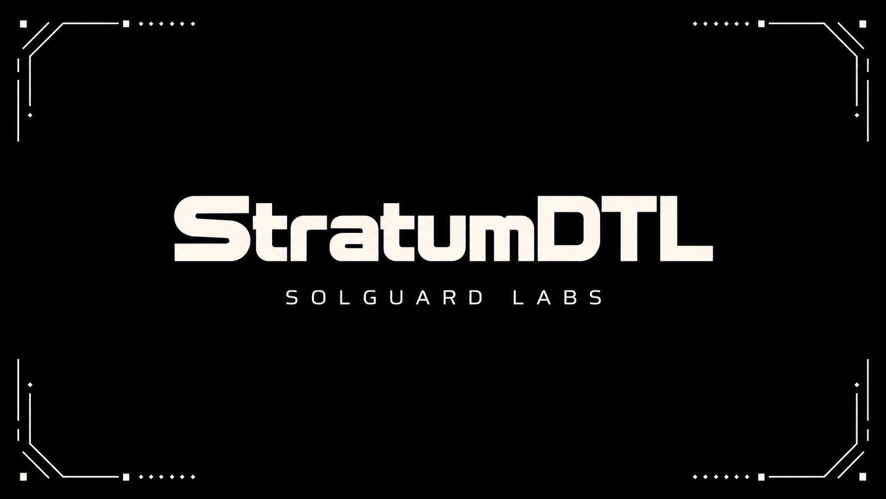
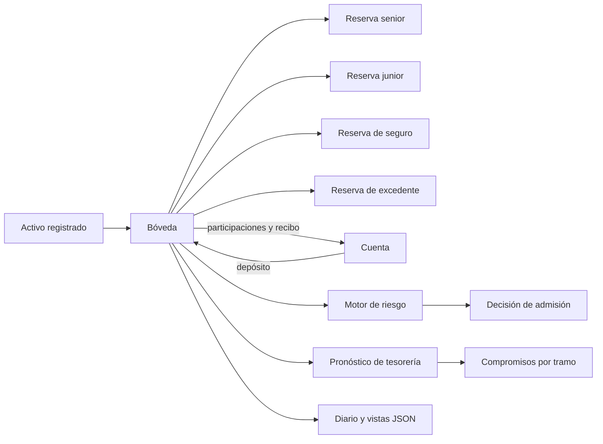
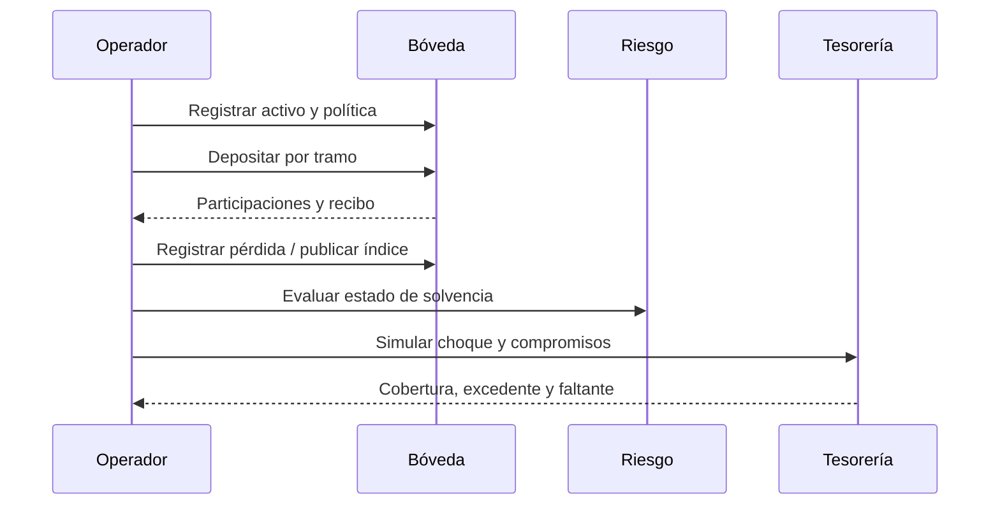

# StratumDTL



StratumDTL es un motor determinista de contabilidad de reservas segmentadas. Organiza un activo en tramos senior, junior, de seguro y de excedente; calcula participaciones, tarifas, pérdidas, liquidaciones y métricas de solvencia sin depender de RPC ni de una base de datos. La biblioteca Rust ofrece estados y recibos tipados; los escenarios JSON permiten integrarla con clientes que necesitan resultados reproducibles.

## Modelo operativo



Cada operación se expresa en unidades enteras del activo. `AssetConfig` conserva los decimales para interpretar esos enteros: si el activo usa seis decimales, `1_000_000` unidades representan una unidad de activo. No hay conversiones implícitas a coma flotante.

| Componente | Responsabilidad |
|---|---|
| `ledger` | Orquesta cuentas, bóvedas, tarifas y diario de eventos. |
| `vault` / `tranche` | Mantiene reservas, participaciones, índices y recibos. |
| `risk` | Clasifica solvencia y admite operaciones según límites configurados. |
| `stress` | Aplica choques deterministas a instantáneas, sin mutar la bóveda. |
| `treasury` | Calcula cobertura de compromisos después de choques y suelos de liquidez. |
| `audit` / `reconciliation` | Contrasta saldos, movimientos y consistencia de vistas. |

## Modelo económico

La emisión inicial de participaciones es 1:1 en unidades enteras. Las operaciones posteriores usan el índice de cada tramo y truncamiento hacia abajo. Las tarifas se calculan en puntos básicos, con `10_000` como 100 %. Las pérdidas se absorben siguiendo la prioridad configurada; la publicación de índices y la liquidación son pasos explícitos del ciclo de vida. Las redenciones usan el modo de liquidez configurado y generan recibos con el origen de cada pago.

Para planificación operativa, el pronóstico de tesorería calcula, por tramo:

```text
reserva_estresada = reserva_inicial - choque_absorbido
suelo = floor(reserva_total_estresada × suelo_bps / 10_000)
disponible = max(0, reserva_estresada - suelo)
faltante = max(0, compromisos - disponible)
cobertura_bps = min(10_000, floor(disponible × 10_000 / compromisos))
```

Cuando no hay compromisos, la cobertura se representa como `10_000` bps. El pronóstico es informativo: no ejecuta transferencias ni sustituye la admisión de riesgo.



## Primeros pasos

Requiere Rust 1.96 y Node.js 24 para las comprobaciones cruzadas. Desde la raíz:

```bash
cargo build --all-targets --locked
cargo test --locked
cargo run --quiet --locked --example liquidity_forecast
node --test "tests/node/*.test.js"
```

El ejemplo de tesorería registra cuatro tramos con `7_000_000` unidades en total, aplica un choque junior de `4_000` bps y evalúa compromisos senior y junior. La salida JSON incluye reservas estresadas, suelos y faltantes, lista para un panel interno. Para el conjunto de validaciones del repositorio: `bash scripts/ci.sh`.

## Documentación

- [Arquitectura y estados](docs/arquitectura.md)
- [Modelo económico y ejemplos](docs/modelo-economico.md)
- [Operación y validación](docs/operacion.md)
- [Contrato de datos JSON](docs/contrato-datos.md)
- [Política de seguridad](SECURITY.md)

La versión `1.0.0` identifica la interfaz documentada de esta biblioteca. El estado publicado se rastrea mediante la rama `production`, el tag anotado `v1.0.0` y las comprobaciones de CI; esos artefactos no implican integración con redes o fondos externos.
