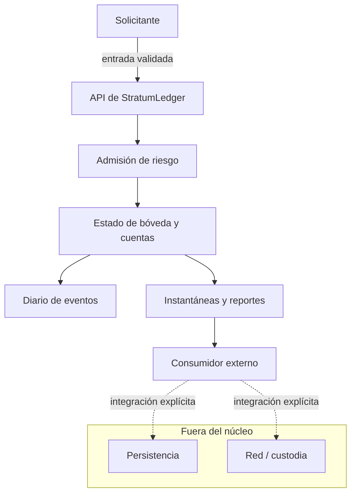

# Política de seguridad de StratumDTL

## Alcance y límites de confianza

La superficie revisable abarca la biblioteca Rust, los ejemplos, el formato JSON y las pruebas de integración. El código no custodia activos ni establece conexión con redes por sí solo. Un integrador que incorpore persistencia, autenticación o liquidación externa debe diseñar y verificar esos límites por separado.



## Controles verificables

- Todas las cantidades monetarias son enteros `u128`; las conversiones de participaciones usan una escala fija de `10^12` y multiplicación comprobada.
- La admisión de depósitos y redenciones combina configuración de activos, límites de tramos y motor de riesgo.
- `AuditEngine`, `InvariantSuite` y `ReconciliationEngine` contrastan estados e instantáneas; su resultado debe conservarse junto con la época y la configuración aplicada.
- El pronóstico de tesorería lee una instantánea y no muta reservas. Calcula faltantes por tramo: un excedente senior no se atribuye automáticamente a un compromiso junior.
- `Cargo.lock` fija dependencias; CI ejecuta formato, compilación, pruebas Rust, Clippy y comprobaciones Node.
- La comprobación de integridad exige que `main`, `production` y `v1.0.0` apunten al mismo commit y que el tag sea anotado.

## Procedimiento ante una incidencia

No publique secuencias sensibles ni datos de terceros en incidencias abiertas. Prepare un informe privado con versión/commit, configuración de activos y política, entradas ordenadas, estado antes y después, resultado esperado, impacto cuantificado y prueba mínima reproducible. Preserve los registros originales y especifique si la observación procede de una integración externa o del núcleo de la biblioteca. Coordine la corrección y su regresión antes de publicar detalles técnicos.

## Validación local

```bash
bash scripts/ci.sh
cargo run --quiet --locked --example liquidity_forecast
```

Para las limitaciones del modelo y la semántica de los reportes, véanse [modelo económico](docs/modelo-economico.md) y [contrato de datos](docs/contrato-datos.md).
