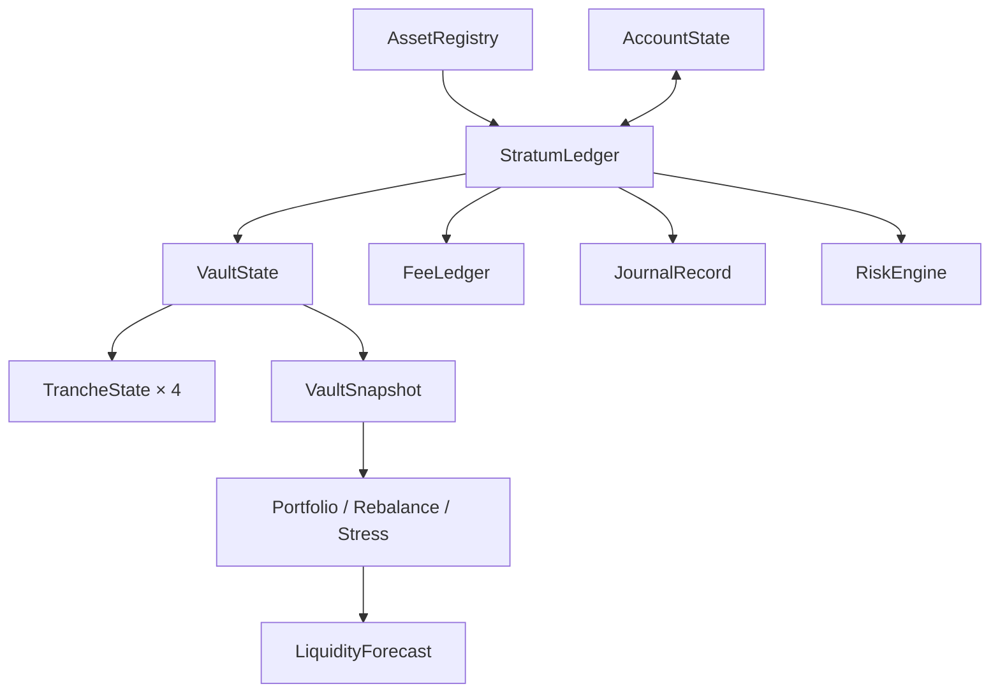

# Arquitectura y ciclo de estado

StratumDTL separa el estado autoritativo (`StratumLedger` y `VaultState`) de las vistas derivadas (`VaultSnapshot`, `PortfolioReport`, `RiskReport` y `LiquidityForecast`). Una vista se calcula a partir de una época concreta y no puede usarse como sustituto de una transacción. La integración responsable conserva el orden de los eventos, la configuración de la bóveda y la versión del cálculo junto a cada resultado.

## Ciclo de una bóveda

1. Registrar un `AssetConfig` con identificador, decimales y límites de importe. Abrir la bóveda con controlador, política de tramos y calendario de tarifas.
2. Admitir depósitos; el libro comprueba el activo y el riesgo, acredita participaciones y registra tarifa y evento. Cada recibo conserva importe bruto, tarifa, neto, participaciones y época.
3. Registrar una pérdida; la reserva se reduce según la prioridad de la política y se abre o amplía una ventana de pérdida. La publicación del índice es una operación explícita cuando la política no la automatiza.
4. Cotizar y admitir redenciones; el recibo detalla `gross_paid`, `net_paid`, tarifa y `paid_from` por tramo. El consumidor externo no debe confundir una cotización con un pago ejecutado.
5. Exportar instantáneas y ejecutar reconciliación. Para reiniciar un proceso, persistir también el orden del diario y la configuración que produjo las vistas.

## Fronteras de datos

El motor no firma transacciones, no custodia claves y no ofrece atomicidad distribuida con sistemas externos. Las funciones mutables operan sobre el estado en memoria recibido. Quien incorpore una base de datos debe serializar operaciones por bóveda y establecer control de concurrencia e idempotencia para depósitos, pérdidas y liquidaciones.

Las instantáneas se serializan con `serde`. No se debe inferir que la ausencia de un tramo en una respuesta parcial equivale a reserva cero; la API completa de la bóveda crea los cuatro tramos. Consulte [contrato de datos](contrato-datos.md) para unidades y campos.
