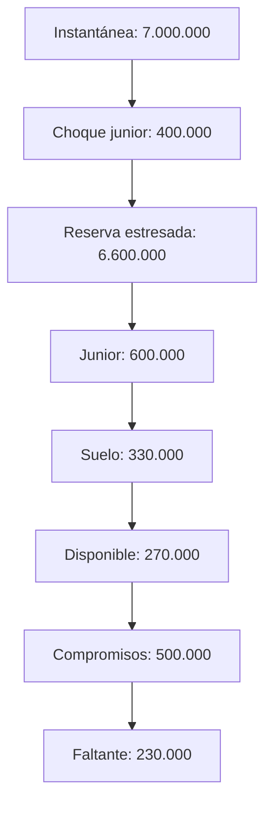

# Modelo económico

## Unidades e índices

`Amount` y `Shares` son enteros sin signo de 128 bits. `Bps` va de 0 a 10.000. `ShareIndex` tiene escala `10^12`: el valor 1:1 es `1_000_000_000_000`. Una conversión de participaciones a importe usa `floor(shares × index / 10^12)`; la inversa usa `floor(amount × 10^12 / index)`. Los productos se comprueban antes de dividir. Los decimales del activo son metadatos de representación, no una división automática en estas fórmulas.

## Tramos y distribución

La política equilibrada usa pesos objetivo del 55 % senior, 25 % junior, 15 % seguro y 5 % excedente para repartir créditos de tarifas. Estos pesos son objetivos de distribución, no un rebalanceo automático de depósitos existentes. La prioridad de absorción de pérdida y los límites de redención son parámetros separados. El modo de redención (`StrictTranche` o `LayeredLiquidity`) determina qué reservas pueden atender una solicitud admitida.

Ejemplo en unidades mínimas: con reservas senior `5_000_000`, junior `1_000_000`, seguro `750_000` y excedente `250_000`, el total es `7_000_000`. Un crédito de tarifas de `100_000` se distribuye como `55_000`, `25_000`, `15_000` y `5_000`. Los recibos y el libro de tarifas permiten verificar que la suma distribuida coincide con el crédito.

## Cobertura de tesorería

El módulo `treasury` permite evaluar compromisos futuros sin alterar los saldos. Primero ejecuta un `StressScenario` sobre una instantánea; después calcula el suelo de cada tramo sobre el total estresado. El importe disponible es la reserva estresada menos el suelo, truncado a cero. Los compromisos repetidos para un mismo tramo se suman con aritmética comprobada. No se compensan faltantes entre tramos.

Ejemplo: sobre la reserva anterior, un choque directo del 40 % de la reserva junior reduce junior de `1_000_000` a `600_000` y el total a `6_600_000`. Con suelo junior de 5 % del total, el suelo es `330_000`; por tanto hay `270_000` disponibles. Frente a compromisos junior de `500_000`, el faltante es `230_000` y la cobertura es `5_400` bps. El cálculo es un indicador de planificación, no un recibo ni una orden de ejecución.

El cálculo de cobertura usa 10.000 bps para compromisos cero y acota la cobertura a 10.000 bps cuando la capacidad supera la obligación. Un resultado `fully_covered = true` significa que cada tramo tiene faltante cero bajo el escenario suministrado; no es una garantía para escenarios no evaluados.
